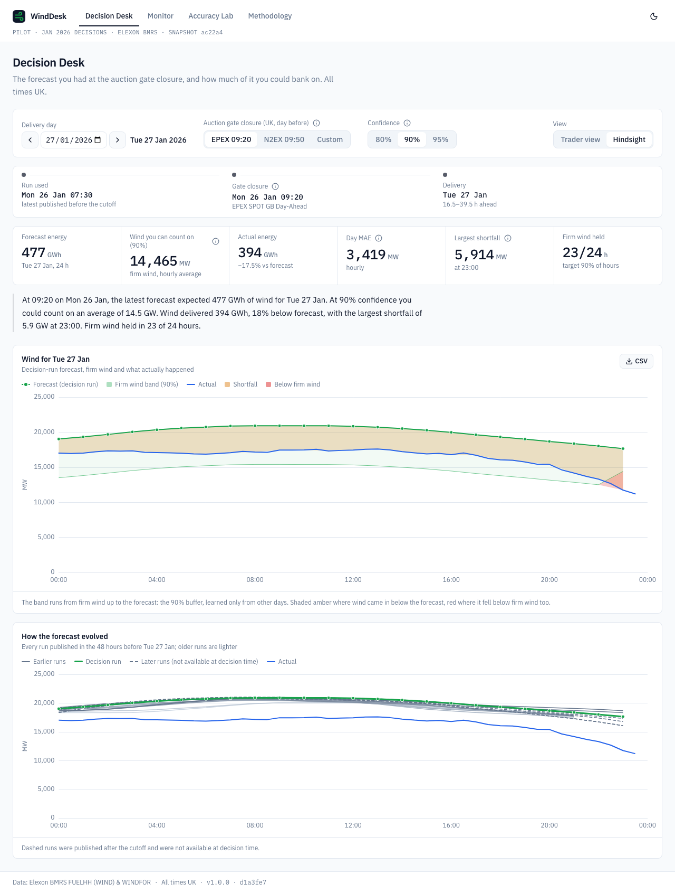
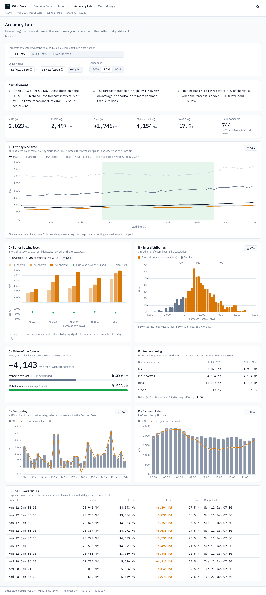
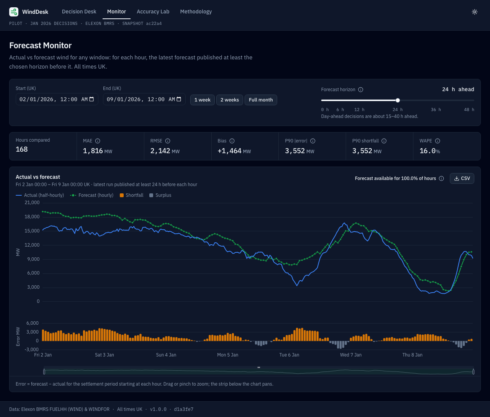
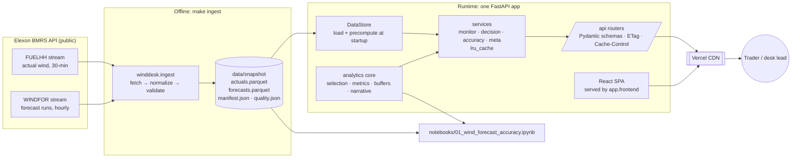

# WindDesk

**For a UK electricity supplier's day-ahead desk: what the national wind forecast said when you had to commit, how wrong it tends to be, and how much wind you can bank on.** The pilot covers every purchase decision made in January 2026.

- **Live app:** https://e26ay-wtpn.vercel.app
- **Demo video (unlisted, ≤ 10 min):** _added after recording_
- **Data:** Elexon BMRS [`FUELHH`](https://bmrs.elexon.co.uk/api-documentation/endpoint/datasets/FUELHH) (actual wind) and [`WINDFOR`](https://bmrs.elexon.co.uk/api-documentation/endpoint/datasets/WINDFOR) (forecast runs), both public. Nothing else.



<details>
<summary>More screenshots: Accuracy Lab, Monitor (dark)</summary>





</details>

## What it does

- **Overview** (`/`): the question the desk asks at 09:20 and the January answer, one real day annotated as Fig. 1, the month in four figures, and a map of the views.
- **Decision Desk** (`/desk`): pick a delivery day and an auction (EPEX 09:20, N2EX 09:50, or a custom cutoff). You see exactly the forecast the desk had at gate closure on the day before, the firm wind you could count on at 80/90/95% confidence, and, in Hindsight view, what actually happened and whether firm wind held.
- **Accuracy Lab:** how wrong the decision forecasts were across the month: MAE, bias, P90 shortfall, error by lead time and by wind level, buffers back-tested without look-ahead, the value of having a forecast at all, and whether the later auction's fresher run is worth it.
- **Monitor:** actual vs forecast for any window at any horizon from 0 to 48 h. **Methodology** explains every definition and data check.

Two optional extras:
- A **procurement what-if** on the Desk. You enter demand and your share of national wind, and it shows what is left to buy at the forecast and at firm wind. It is illustrative and runs in the browser.
- A **Live** tab, off by default. It shows tomorrow's forecast as of now, live from Elexon (`WINDDESK_ENABLE_LIVE=true`; see [API.md](docs/API.md)).

Headline findings, from [`docs/INSIGHTS.md`](docs/INSIGHTS.md):

- At the 09:20 cutoff, tomorrow's forecast is typically off by **2,023 MW**, and it runs high by **1,746 MW** on average.
- Planning on P90 firm wind held in **87%** of hours, against a 90% target, in a back-test that never looks ahead.
- With the forecast you can bank **4,143 MW** more wind on an average hour than without it. Bidding at 09:50 instead of 09:20 improves accuracy by only **1.3%**.

## How to start

**Docker (one line, nothing else to install):**

```bash
docker compose up --build        # → http://localhost:8000
```

**Local development** needs Python 3.12 with [uv](https://docs.astral.sh/uv/), and Node 20.19+ (22 recommended):

```bash
make setup     # uv sync + npm ci + git hooks
make dev       # FastAPI on :8000 and Vite on :5173 → open http://localhost:5173
make check     # the gate: lint + types + tests + build
make test-e2e  # Playwright smoke tests (first time: npx --prefix frontend playwright install chromium)
```

The repo ships a validated data snapshot (`data/snapshot/`), so the app runs offline. To rebuild it from Elexon:

```bash
make ingest                    # fetch → normalise → validate → write data/snapshot/
make ingest ARGS="--offline"   # rebuild from the local raw cache only
make notebook                  # re-run the analysis notebook; it rewrites docs/INSIGHTS.md
```

No secrets are needed. `.env.example` lists the optional settings. `WINDDESK_ENABLE_LIVE=true` switches on the Live tab, which calls Elexon at request time; it is off by default because the brief limits the data to the pilot window. Run `make help` for every target.

## Files and directories

| Path | What it is |
|---|---|
| `backend/winddesk/` | The Python package: one FastAPI app serving `/api` and the built SPA |
| `backend/winddesk/analytics/` | **Pure** analytics with no I/O: run selection (`selection.py`), metrics, LODO buffers, accuracy breakdowns, the decision day, templated narrative text, pilot constants |
| `backend/winddesk/ingest/` | `python -m winddesk.ingest`: Elexon client, normalisation to UTC, data-quality checks |
| `backend/winddesk/services/` | Cached use cases (monitor, decision, accuracy, meta, and the optional live mode) that call analytics on the loaded store |
| `backend/winddesk/api/` | Thin routers, Pydantic schemas, parameter validation, ETag/Cache-Control, the error envelope, OpenAPI export |
| `backend/winddesk/main.py` · `store.py` · `config.py` | App factory, the in-memory data store built at startup, settings |
| `backend/tests/` | pytest: `analytics/` (hand-computed expected values), `api/`, `ingest/`, and `contract/` (real-snapshot tests, marker `snapshot`) |
| `frontend/e2e/` · `frontend/playwright.config.ts` | Playwright smoke tests (desktop and 375 px) on the production app |
| `frontend/src/pages/` | Overview (home), Decision Desk, Monitor, Accuracy Lab, Methodology, plus the not-found and error pages (lazy-loaded) |
| `frontend/src/components/` | `charts/` (one ECharts wrapper plus pure option builders), `controls/`, `kpi/`, `layout/`, `feedback/`, `ui/` (shadcn) |
| `frontend/src/api/` | Typed client: `schema.d.ts` is **generated** from OpenAPI (`make gen-api`); `queries.ts` holds the TanStack Query hooks |
| `frontend/src/lib/` | All formatting (`format.ts`, `time.ts` in Europe/London), URL state, CSV export, glossary |
| `frontend/src/styles/globals.css` | Design tokens (light and dark): actual = blue, forecast = green, shortfall = amber |
| `data/snapshot/` | The committed, validated snapshot: `actuals.parquet`, `forecasts.parquet`, `manifest.json` (provenance), `quality.json` (checks) |
| `data/raw/` | Raw API cache written by `make ingest` (git-ignored) |
| `notebooks/01_wind_forecast_accuracy.ipynb` | The analysis, executed with outputs. It imports the same analytics functions as the app and writes `docs/INSIGHTS.md` |
| `docs/` | `PRD.md` (scope), `DATA_AND_ANALYTICS.md` (algorithms), `API.md`, `ARCHITECTURE.md`, `UI_SPEC.md`, `adr/` (decision records), `INSIGHTS.md` (findings, written by the notebook), `screenshots/` |
| `Dockerfile` · `docker-compose.yml` | Production image (Node build stage, then a slim Python runtime) · local run and hot-reload profile |
| `vercel.json` · `pyproject.toml` `[tool.vercel]` | Vercel build command, function bundle exclusions, and the FastAPI entrypoint |
| `pyproject.toml` · `uv.lock` | The one Python manifest and lockfile (with ruff, mypy, pytest and coverage config) |
| `Makefile` | Every command: `setup`, `dev`, `ingest`, `test`, `test-contract`, `lint`, `typecheck`, `gen-api`, `build`, `notebook`, `docker-up`, `check` |
| `.github/workflows/ci.yml` | CI: backend, frontend and Docker smoke-test jobs |
| `.pre-commit-config.yaml` · `.editorconfig` · `.python-version` · `.env.example` · `.dockerignore` · `.gitignore` | Tooling and environment config |

## Architecture

The pilot window is frozen, so the data is an **ingested, validated Parquet snapshot rather than a database** ([ADR-0001](docs/adr/0001-snapshot-not-database.md)). **One FastAPI app** serves both `/api` and the React SPA, giving one origin and identical behaviour in Docker and on Vercel ([ADR-0002](docs/adr/0002-single-app-single-origin.md)). The analytics core is pure functions ([ADR-0003](docs/adr/0003-pure-analytics-core.md)), the forecast-selection rules are fixed in [ADR-0004](docs/adr/0004-selection-alignment-no-lookahead.md), and the API is contract-first with generated TypeScript types ([ADR-0005](docs/adr/0005-contract-first-typed-api.md)).



- **Backend:** Python 3.12, FastAPI, pandas, Pydantic v2. The store loads the snapshot and precomputes both auctions' decision pairs, buffers and calibration at startup (about 0.3 s). Warm requests are answered from `lru_cache`, and responses carry an ETag, `Cache-Control` and `X-Snapshot-Id`.
- **Frontend:** React 19, TypeScript (strict), Vite, Tailwind 4 with shadcn/ui, TanStack Query, React Router, and Apache ECharts (modular, loaded on first chart mount). View state lives in the URL, so every view is a shareable link.
- More detail: [`docs/ARCHITECTURE.md`](docs/ARCHITECTURE.md) · API reference: [`docs/API.md`](docs/API.md), plus live OpenAPI at `/api/docs` · UI rules: [`docs/UI_SPEC.md`](docs/UI_SPEC.md).

## Methodology

The full specification is [`docs/DATA_AND_ANALYTICS.md`](docs/DATA_AND_ANALYTICS.md), and the in-app Methodology page explains the same rules in plain language.

| Term | Definition |
|---|---|
| **Decision cutoff** | The auction's gate closure on the day before delivery (D−1), in UK time: EPEX SPOT GB Day-Ahead 09:20, N2EX 09:50, or a custom time. It is converted to UTC per day, so BST is handled. |
| **Decision run** | The latest WINDFOR run with `publish_time ≤ cutoff`. On every pilot day that is the D−1 07:30 UTC run for EPEX (16.5–39.5 h ahead) and the 09:30 UTC run for N2EX (14.5–37.5 h ahead). **No look-ahead:** nothing published after the cutoff influences that day. |
| **Forecast at horizon H** (Monitor) | For each hour, the latest run published at least H hours before it. |
| **Alignment** | The hourly forecast for H is compared with the settlement period that starts at H ([ADR-0004](docs/adr/0004-selection-alignment-no-lookahead.md)). Using the hourly mean instead changes MAE by 16 MW. |
| **Error** | `error = forecast − actual` (MW). Positive means over-forecast, which for a buyer is a **shortfall**. |
| **MAE · RMSE · bias · WAPE** | mean \|e\| · √mean e² · mean e · 100 × Σ\|e\| / Σ actual |
| **P90 shortfall** | The 90th percentile of the error, floored at 0: the buffer that would have covered 90% of hours. |
| **Buffer and firm wind** | Leave-one-day-out: each day's buffer is learned only from the other days' errors, by forecast-level bin (quintiles; a bin with fewer than 30 hours uses the single pooled buffer). `firm = max(forecast − buffer, 0)`. |
| **Firm wind held** | Hours where `actual ≥ firm`. Calibration compares that share with the target confidence. |
| **Value of the forecast** | Average firm wind with the forecast, versus what you could bank with no forecast (the P10 of actual wind). |

**Invariants that are tested:** no look-ahead; UTC tz-aware storage and Europe/London display; gaps stay gaps (a missing hour is never filled from another run); units appear in every name and label. Narrative sentences come from tested templates, and no LLM generates text in the product.

## Testing and quality gates

`make check` is the single gate. CI runs it on every push and pull request:

| Layer | What runs |
|---|---|
| Backend | `ruff` (lint and format), `mypy --strict` on analytics, services and api, and **450 pytest tests**: 307 fast tests, gated at ≥ 90% line coverage on `winddesk.analytics` (currently 99%), plus 143 contract tests on the real snapshot |
| Frontend | ESLint, Prettier, `tsc` (strict, no `any`), **103 Vitest tests** (formatting, URL state, chart option builders, every page's states), and a production build |
| API contract | `make gen-api-check`: CI fails if the committed TypeScript types drift from the OpenAPI schema |
| End-to-end | `make test-e2e`: **Playwright** against FastAPI serving the production build, at desktop width and 375 px. Every page loads, one control changes the view, the charts actually paint, there are no console errors and no horizontal overflow. It runs as its own CI job, and `make test-e2e-prod` runs it against the live URL |
| Docker | The image is built, run and smoke-tested (`/api/health` and the SPA) in CI |

Measured on the production Docker image:

- **API:** 1–11 ms warm and at most 38 ms cold, against a 300 ms budget.
- **JS:** about 390 KB gzipped in total (budget 450 KB). The ECharts chunk loads only when a chart mounts.
- **LCP:** 0.5–0.7 s unthrottled and 1.4–2.1 s on Lighthouse-style slow 4G (budget 2.5 s).

On the live URL, measured from India: slow-4G LCP is 1.8–2.0 s. CDN-cached API responses take a median of 65–119 ms. Uncached ones reach the London function, where the India–London round trip alone is about 180 ms, and server work adds about 20–140 ms.

## Deployment

**Vercel (primary; live at https://e26ay-wtpn.vercel.app).** Import the GitHub repo at vercel.com/new as **one** project with the Root Directory left at the repo root (from a subfolder Vercel can't see `pyproject.toml` and fails with `FASTAPI_ENTRYPOINT_NOT_FOUND`), keep the **FastAPI** framework preset that `vercel.json` pins, and deploy. There are no environment variables to set. Vercel runs `npm --prefix frontend ci && npm --prefix frontend run build`, bundles `backend.winddesk.main:app` (from `[tool.vercel] entrypoint`) as one Python function with the data snapshot inside it, and promotes `frontend/dist` to its CDN (`[tool.vercel.fastapi.static] cdn = true`, needed because the app has GZip middleware). After the deploy, check `/api/health` (it reports the snapshot id and git SHA), a deep link such as `/accuracy`, and an unknown `/api/x`, which should return a JSON 404. `make test-e2e-prod` then runs the Playwright smoke tests against the live URL. The function runs in London (`regions: ["lhr1"]`), next to the desk and to Elexon.

**Docker, anywhere.** The image listens on `$PORT` (default 8000), has a health check, and needs no secrets:

```bash
docker build -t winddesk --build-arg GIT_SHA=$(git rev-parse --short HEAD) .
docker run -p 8000:8000 winddesk
```

The same image runs on any container host that sets `$PORT`, such as Heroku.

## AI tools used

This project was built with **Claude Code (Anthropic)** under human direction and review.

- **Planning documents:** the PRD, the data and analytics spec, the API, architecture and UI specs, the ADRs in `docs/`, and a phased build plan were drafted with Claude Code from the human's brief. The human then set the scope and the priorities (MoSCoW) and decided the open questions.
- **Implementation:** Claude Code wrote the code, tests, notebook and docs phase by phase, following written working rules. Each phase ended with its definition of done checked and the evidence logged. The human reviewed and approved the work phase by phase, gave UI feedback, and did all account actions (GitHub, Vercel). In the later phases, under a standing instruction, Claude Code also took and logged routine implementation decisions itself.
- **What was verified rather than trusted:**
  - Elexon's API behaviour was probed live before any code was written (DATA §1).
  - Analytics tests use small synthetic datasets whose expected values are worked out by hand in the test, not copied from the code's output.
  - Contract tests check the real snapshot's structure (8 runs a day, 73 points per run, 48 periods a day), no look-ahead on every day through both the analytics and the API, and calibration within 5 points of target.
  - The notebook recomputes the findings independently of the API.
  - Every page was screenshot-checked at 1280 px and 375 px in light and dark modes.
  - Performance was measured, not estimated.
- No AI-generated text appears in the product: narrative sentences come from tested templates.

## Limitations and next steps

- **One month of data.** P95 is a small-sample estimate, P99 is not offered as a buffer, and seasonality is not captured.
- **Systematic over-forecast** (+1,746 MW at the decision point, growing with wind level). It is consistent with constraint curtailment or a scope difference between WINDFOR and FUELHH, and is a hypothesis to confirm with the client. The buffers absorb it.
- **National wind is a proxy** for the supplier's own exposure, and embedded (distribution-connected) wind is not visible in either dataset.
- **Leave-one-day-out back-test**, not a strictly expanding window. A production version would calibrate on earlier days only.
- **Symmetric statistics.** A cost-weighted buffer needs the client's imbalance prices.

Next: rolling calibration, portfolio-level data, a buffer weighted by imbalance cost, and scheduled live ingestion with alerts.
