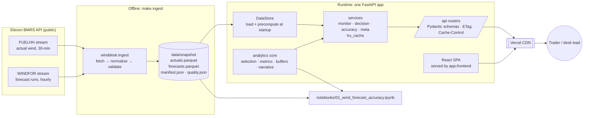
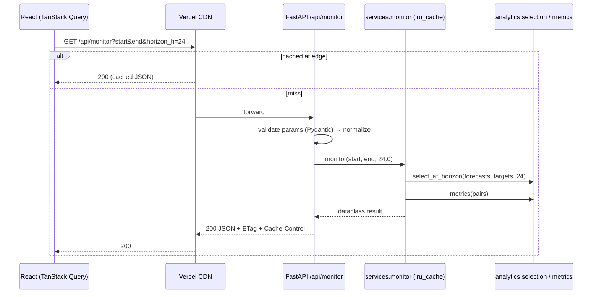

# WindDesk — Architecture

## 1. Principles

1. **The data is a frozen pilot window, so use a snapshot, not a database.** About 20k rows. It is ingested once, validated, committed as Parquet, and loaded into memory at startup (ADR-0001).
2. **One app, one origin, everywhere.** A single FastAPI app serves `/api/*` and the built React SPA. The same code runs in `uvicorn`, in Docker and on Vercel (ADR-0002).
3. **A pure analytics core.** All domain logic is in pure, unit-tested pandas functions. The API and UI are thin layers on top (ADR-0003).
4. **Correctness invariants are explicit and tested:** no look-ahead, timezone safety, error sign (ADR-0004).
5. **Contract-first.** Pydantic models define the API, and TypeScript types are generated from OpenAPI (ADR-0005).
6. **Reproducible:** `make ingest` rebuilds the snapshot, `make check` is the single quality gate, and the notebook runs on the same analytics code.

## 2. System view



### Request flow (example: Monitor)



## 3. Repository layout

```
<repo>/
├── CLAUDE.md                     # instructions for Claude Code
├── README.md                     # submission README (written in Phase 8)
├── Makefile                      # single entry point for every task
├── pyproject.toml / uv.lock      # Python project, tool config, [tool.vercel]
├── .python-version               # 3.12
├── vercel.json                   # build command, function config
├── Dockerfile                    # multi-stage: build SPA → slim Python runtime
├── docker-compose.yml            # `app` (prod image) + `dev` profile (hot reload)
├── heroku.yml                    # optional fallback deploy (container)
├── .github/workflows/ci.yml      # lint · typecheck · test · build · docker build
├── .pre-commit-config.yaml
├── backend/
│   ├── winddesk/                 # the Python package (relative imports inside)
│   │   ├── main.py               # create_app() and module-level `app`
│   │   ├── config.py             # Settings (pydantic-settings, env prefix WINDDESK_)
│   │   ├── store.py              # DataStore: load snapshot, build pairs, precompute
│   │   ├── ingest/               # __main__.py (CLI), client.py, normalize.py, validate.py
│   │   ├── analytics/            # PURE: timeutil, selection, metrics, buffers,
│   │   │                         #       decision, accuracy, narrative
│   │   ├── services/             # orchestration + caching: meta, monitor, decision, accuracy
│   │   └── api/                  # routers, schemas, deps, caching, errors (see API.md)
│   └── tests/
│       ├── conftest.py           # synthetic fixture dataset (hand-computable)
│       ├── analytics/            # unit tests (DATA §7)
│       ├── api/                  # TestClient tests per endpoint
│       └── contract/             # @pytest.mark.snapshot: real-data contract tests
├── data/
│   ├── snapshot/                 # committed: parquet + manifest.json + quality.json
│   └── raw/                      # gitignored raw API responses
├── frontend/
│   ├── index.html, vite.config.ts, tsconfig*.json, package.json
│   └── src/
│       ├── main.tsx, router.tsx
│       ├── api/                  # schema.d.ts (GENERATED), client.ts, queries.ts
│       ├── pages/                # DecisionDesk/, Monitor/, AccuracyLab/, Methodology/
│       ├── components/
│       │   ├── layout/           # AppShell, TopNav, ThemeToggle, DataBadge
│       │   ├── charts/           # EChart wrapper, theme.ts, one file per chart
│       │   ├── kpi/              # KpiCard, MetricsStrip
│       │   ├── controls/         # date pickers, AuctionSelector, HorizonSlider, …
│       │   └── feedback/         # Skeleton, ErrorState, EmptyState, InfoTip
│       ├── lib/                  # format.ts, time.ts, urlState.ts, csv.ts
│       └── styles/globals.css    # design tokens
├── notebooks/01_wind_forecast_accuracy.ipynb
└── docs/                         # PRD, ARCHITECTURE, API, DATA_AND_ANALYTICS, UI_SPEC,
                                  # PLAN, PROGRESS, INSIGHTS, DEMO_SCRIPT, adr/
```

## 4. Backend

**Stack:** Python 3.12 · FastAPI · Pydantic v2 · pydantic-settings · pandas · numpy · pyarrow · httpx (ingest only) · uvicorn.
**Dev:** uv · ruff (lint + format) · mypy (strict on `analytics`, `api`, `services`) · pytest · pytest-cov · jupyter · matplotlib.

Layers (dependencies point downward only):

| Layer | Responsibility | May import |
|---|---|---|
| `api` | HTTP: params, schemas, status codes, headers | services, config |
| `services` | Orchestrate analytics for a use case; cache by primitive params | analytics, store |
| `store` | Load snapshot; build `pairs`, decision pools and calibration at startup | analytics, config |
| `analytics` | Pure domain functions. No I/O, no FastAPI. | pandas, numpy, stdlib |
| `ingest` | Offline CLI: fetch, normalize, validate, write snapshot | analytics.timeutil, config |

**Startup:** a FastAPI `lifespan` builds a singleton `DataStore` (also created lazily on first use, so the serverless path is safe). Target: under 1 s.

**Static SPA:** `app.frontend("/", directory="frontend/dist", fallback="index.html")`. Every `/api` route takes priority. If the installed FastAPI version lacks `app.frontend`, fall back to a `StaticFiles` mount plus an SPA catch-all route for non-`/api` GETs. Keep the directory as a **literal string** so Vercel can detect it and promote the files to its CDN.

**No middleware unless needed.** Vercel keeps static files inside the function when top-level middleware exists. The Vite dev proxy removes the need for CORS. If middleware is added (e.g. a request-id logger), set `[tool.vercel.fastapi.static] cdn = true`.

**Logging:** stdlib `logging` with a one-line JSON formatter: timestamp, level, path, duration_ms, status. Log startup timing and snapshot id.

## 5. Frontend

**Stack:** Vite · React 19 · TypeScript (strict) · React Router · TanStack Query · Tailwind CSS v4 + shadcn/ui · Apache ECharts (modular imports, thin wrapper) · openapi-typescript + openapi-fetch · Vitest + Testing Library · ESLint + Prettier.

- **Server state:** TanStack Query hooks in `api/queries.ts` (`useMeta`, `useMonitor`, `useDecision`, `useAccuracy`). Use `staleTime: Infinity`, because the data is a frozen snapshot, and `placeholderData: keepPreviousData` so charts don't flash while a slider moves.
- **View state:** URL search params through a typed `useUrlState` helper (PRD F6). Debounce the horizon slider (150 ms) before the URL/query update.
- **Charts:** one `EChart` wrapper handles init/dispose, resize (ResizeObserver), theme switch and `aria-label`. Each chart component maps API data to an option object and has no fetching logic.
- **Formatting:** all UK-time and number formatting lives in `lib/format.ts` and `lib/time.ts` (`Intl.DateTimeFormat` with `timeZone: 'Europe/London'`). Never call `toLocaleString()` ad hoc.
- **Dev server:** Vite proxies `/api` to `http://localhost:8000`.

## 6. Deployment

### 6.1 Vercel (primary: public demo URL)
One Vercel project imported from the GitHub repo. FastAPI becomes a single Vercel Function. The SPA build is promoted to the CDN.

Sketch (to be validated in Phase 0 with `vercel build`; adjust to what actually works and record the result in `PROGRESS.md`):

```toml
# pyproject.toml
[tool.vercel]
entrypoint = "backend.winddesk.main:app"   # winddesk must use relative imports internally

[tool.vercel.fastapi.static]
exclude = true      # don't duplicate the SPA inside the function bundle
# cdn = true        # only if middleware is added
```

```json
// vercel.json
{
  "$schema": "https://openapi.vercel.sh/vercel.json",
  "buildCommand": "npm --prefix frontend ci && npm --prefix frontend run build",
  "functions": {
    "backend/winddesk/main.py": {
      "maxDuration": 30,
      "excludeFiles": "{frontend/node_modules/**,frontend/src/**,notebooks/**,backend/tests/**,data/raw/**,docs/**}"
    }
  }
}
```

**Fallback** if the entrypoint or import path misbehaves: add a root `index.py` shim that inserts `backend/` into `sys.path` and does `from winddesk.main import app`.

Gotchas to verify:
- One dependency manifest only: `pyproject.toml` + committed `uv.lock`, and **no** `requirements.txt`. Runtime deps stay minimal; dev tools go in `[dependency-groups]`. Check the bundle size in the `vercel build` output; it must be under the 500 MB Python limit.
- The data snapshot **must be inside** the function bundle. Assert this with a `/api/health` check after deploy.
- Deep links (`/monitor`) must load the SPA from a cold browser.
- Submit the **production** domain (`<project>.vercel.app`). Preview URLs may sit behind Vercel deployment protection. Verify in incognito.

### 6.2 Docker (local and reviewer reproducibility)
- `Dockerfile`, multi-stage: `node:22-slim` builds `frontend/dist`, then `python:3.12-slim` with `uv sync --frozen --no-dev`. It copies `backend/`, `data/snapshot/` and the built `frontend/dist`, runs as a non-root user, listens on `$PORT` (default 8000), and has a `HEALTHCHECK` on `/api/health`.
- `docker compose up --build` gives the full app on http://localhost:8000.
- `docker compose --profile dev up api-dev web-dev` gives hot reload (uvicorn `--reload` plus the Vite dev server on :5173).

### 6.3 Heroku (fallback only)
`heroku.yml` uses the same Dockerfile (`build: docker: web: Dockerfile`). Heroku has no free tier, so use it only if Vercel blocks.

### 6.4 Configuration
| Env var | Default | Purpose |
|---|---|---|
| `WINDDESK_DATA_DIR` | `data/snapshot` | snapshot location |
| `WINDDESK_ENABLE_LIVE` | `false` | Could-have live mode |
| `WINDDESK_LOG_LEVEL` | `INFO` | logging |
| `GIT_SHA` / `VERCEL_GIT_COMMIT_SHA` | – | shown in `/api/health` |

No secrets are required. `.env.example` documents the variables above.

## 7. Quality and delivery

| Gate | Command (via Makefile) |
|---|---|
| Lint/format | `ruff check`, `ruff format --check`, `eslint`, `prettier --check` |
| Types | `mypy backend/winddesk`, `tsc --noEmit` |
| Tests | `pytest -m "not snapshot"` (fast), `pytest -m snapshot` (contract), `vitest run` |
| API types fresh | `make gen-api && git diff --exit-code frontend/src/api/schema.d.ts` |
| Build | `npm run build`, `docker build .` |
| **All** | `make check` |

- **CI:** GitHub Actions on push/PR runs backend, frontend and docker-build jobs.
- **Commits:** Conventional Commits, one logical change each. Tag `v1.0.0` at release.
- **Coverage:** ≥ 90% on `analytics`; API endpoints each have a happy-path test plus a 422 test.
- **Performance budgets:** API p95 < 300 ms warm on Vercel; JS < 450 KB gzipped (use ECharts modular imports); LCP < 2.5 s.
- **Accessibility:** keyboard-navigable controls, visible focus, AA contrast, charts with `aria-label` and a data-table alternative (CSV download).

### Makefile targets (create in Phase 0)
`setup` · `dev` (api + web in parallel) · `dev-api` · `dev-web` · `ingest` · `test` · `test-contract` · `lint` · `format` · `typecheck` · `gen-api` · `build` · `notebook` (execute in place) · `docker-build` · `docker-up` · `check` · `clean`

## 8. Decisions (ADRs)

| ADR | Decision |
|---|---|
| [0001](adr/0001-snapshot-not-database.md) | Committed Parquet snapshot instead of a database or runtime API calls |
| [0002](adr/0002-single-app-single-origin.md) | One FastAPI app serves API and SPA; identical in Docker and Vercel |
| [0003](adr/0003-pure-analytics-core.md) | Pure pandas analytics core shared by API and notebook |
| [0004](adr/0004-selection-alignment-no-lookahead.md) | Forecast selection rules, alignment policy, no-look-ahead invariant |
| [0005](adr/0005-contract-first-typed-api.md) | OpenAPI-generated TypeScript types |

## 9. Risks and mitigations

| Risk | Mitigation |
|---|---|
| Vercel Python bundling or entrypoint quirks | Deploy a walking skeleton in **Phase 0**, before any feature work; documented fallback shim; verify the bundle with `vercel build` |
| `app.frontend` unavailable in the installed FastAPI | StaticFiles + SPA catch-all fallback (§4) |
| WINDFOR cadence/window differs from the sampled days | Data-contract tests in Phase 1; algorithms rely on `publish_time`/`target_time`, not on assumed cadence |
| Timezone bugs | UTC internally; a single `timeutil` module; a BST test case |
| Scope creep vs the 16 h budget | MoSCoW in the PRD; Should/Could only after Must passes; time boxes in PLAN |
| Elexon unavailable during development | Raw cache + committed snapshot; runtime never calls Elexon |
| Small-sample tails (P95/P99) | Shown with caveats; P99 not offered as a buffer |
